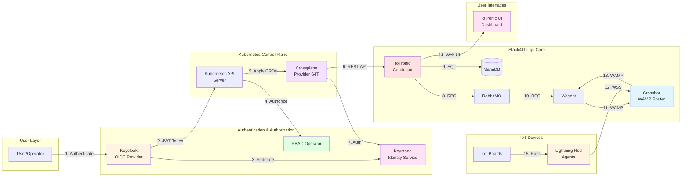

# Stack4Things on Kubernetes with Crossplane, Keycloak and Keystone

This repository deploys **Stack4Things (IoTronic)**, an OpenStack-based IoT cloud-to-edge platform, on a single-node **k3s** cluster and lets you manage boards, plugins and services declaratively with **Crossplane**: a custom provider (`provider-s4t`, Go) turns Kubernetes custom resources into calls to the IoTronic REST API. Authentication is delegated to **Keycloak** (OIDC) federated with **Keystone**, and per-project authorization to an RBAC operator.

Why: IoTronic is normally operated through its own UI/CLI. Exposing it as Kubernetes resources makes board and plugin lifecycle GitOps-friendly and lets Kubernetes RBAC govern who can touch which devices.

> Reproducibility note: everything that needs a cluster (k3s, Istio, MetalLB, Crossplane, Keycloak, boards) was **not verified in this environment**. Static checks were run and are listed in section 6.

## Contents

1. [Architecture](#1-architecture) 2. [Requirements](#2-requirements) 3. [Installation](#3-installation-step-by-step) 4. [Configuration](#4-configuration) 5. [Usage end to end](#5-usage-end-to-end) 6. [Testing and verification](#6-testing-and-verification) 7. [Repository structure](#7-repository-structure) 8. [Troubleshooting](#8-troubleshooting) 9. [Limitations and security](#9-limitations-and-security) 10. [Extending](#10-extending) 11. [Detailed reference](#11-detailed-reference)

## 1) Architecture



Components deployed from `stack4things-improved/yaml_file/`:

| Component | Image | Role |
|---|---|---|
| MariaDB (`iotronic-db`) | `mariadb:10.6` / `mariadb:focal` | IoTronic and Keystone databases |
| RabbitMQ | `rabbitmq:3.7-management` | RPC bus conductor <-> wagent |
| Crossbar | `crossbario/crossbar` | WAMP router for Lightning Rod agents (port 8181) |
| IoTronic conductor / wagent / wstun | `lucadagati/iotronic-*` | control plane, WAMP agent, reverse tunnels (ports 50001-50012) |
| IoTronic UI (Horizon) | `lucadagati/iotronic-ui` | dashboard (`/horizon`) |
| Keystone | `lucadagati/iotronic-keystone` + OIDC module | identity service, federated to Keycloak |
| Keycloak | `quay.io/keycloak/keycloak:24.0.4` (+ `postgres:15`) | OIDC provider, realm `stack4things` |
| Lightning Rod | `lucadagati/lrod:compose` | emulated board agent (one pod per board) |
| provider-s4t | built from `crossplane-provider/` | Crossplane provider, API group `iot.s4t.crossplane.io/v1alpha1` |

The provider manages the kinds `Device`, `Plugin`, `Service`, `Port`, `Fleet`, `Webservice`, `Request`, `Result`, `Site`, `BoardPluginInjection`, `BoardServiceInjection` (CRDs in `crossplane-provider/package/crds/`).

## 2) Requirements

| Item | Version / note |
|---|---|
| OS | Linux with systemd, root/sudo, `curl`, `git`, `openssl`, `bash` |
| k3s | current stable (single node, `--bind-address=0.0.0.0`) |
| kubectl, Helm | v3 (kubectl 1.3x was used for the static checks) |
| MetalLB | v0.13.10 |
| Istio | Helm charts `base`, `istiod`, `gateway` |
| Crossplane | installed by the deploy script |
| Go | 1.21+ (module `go 1.21.13`), only to build the provider |
| Docker | only for the legacy compose stack or image builds |

## 3) Installation step by step

All commands as in the original deployment procedure; **not verified in this environment**.

```bash
git clone https://github.com/lucadagati/stack4things-crossplane-deployment.git
cd stack4things-crossplane-deployment

# 1. k3s
curl -sfL https://get.k3s.io | sh -s - --bind-address=0.0.0.0
sudo chmod 644 /etc/rancher/k3s/k3s.yaml
export KUBECONFIG=/etc/rancher/k3s/k3s.yaml

# 2. Helm, MetalLB, Istio
curl -fsSL -o get_helm.sh https://raw.githubusercontent.com/helm/helm/main/scripts/get-helm-3 && chmod 700 get_helm.sh && ./get_helm.sh
kubectl apply -f https://raw.githubusercontent.com/metallb/metallb/v0.13.10/config/manifests/metallb-native.yaml
helm repo add istio https://istio-release.storage.googleapis.com/charts && helm repo update
helm install istio-base istio/base -n istio-system --create-namespace
helm install istiod istio/istiod -n istio-system --wait
helm install istio-ingress istio/gateway -n istio-ingress --create-namespace --wait

# 3. Secrets are not committed: choose a Keystone client secret (optional, random if unset)
export KEYSTONE_CLIENT_SECRET="$(openssl rand -hex 16)"
# RBAC operator sources are not in this repo (see section 9)
export RBAC_OPERATOR_REPO=<git url of the rbac operator>   # optional

# 4. Deploy everything
cd stack4things-improved
./deploy-complete-improved.sh
```

The script deploys the Stack4Things services, installs Crossplane, builds/installs provider-s4t (`crossplane-provider/`), deploys Keycloak and Keystone (`scripts/deploy-keycloak-keystone.sh`, which also generates a self-signed Keycloak certificate with `openssl`) and the RBAC operator (`scripts/deploy-rbac-operator.sh`), and creates the `ProviderConfig`. Afterwards check:

```bash
kubectl get pods -A | grep -E "iotronic|crossplane|keycloak|keystone"
kubectl get provider
```

Optional OIDC login for kubectl: `stack4things-improved/scripts/configure-k3s-oidc.sh`.

Legacy docker-compose variant: `cd stack4things && cp .env.example .env && docker compose up -d` (not verified).

## 4) Configuration

| Setting | Where | Default / meaning |
|---|---|---|
| `KEYSTONE_CLIENT_SECRET` | env, read by `deploy-keycloak-keystone.sh` | random `openssl rand -hex 16`; substituted for `__KEYSTONE_CLIENT_SECRET__` in the realm JSON and `wsgi-keystone.conf` |
| `RBAC_OPERATOR_REPO` | env, `deploy-rbac-operator.sh` | git URL cloned into `stack4things-improved/rbac-operator/` if absent |
| `IMG` | env, `deploy-rbac-operator.sh` | operator image (`localhost:5000/s4t-rbac-operator:latest`) |
| `KUBECONFIG` | env | scripts fall back to `/etc/rancher/k3s/k3s.yaml` |
| `stack4things/.env` | copy of `.env.example` | MariaDB, RabbitMQ, Keystone credentials and DB connection strings for the legacy stack (lab defaults: change them) |
| `conf_conductor/iotronic.conf`, `conf_wagent/iotronic.conf` | `stack4things-improved/` | IoTronic service configuration (also embedded in `yaml_file/*-cm0-configmap.yaml`) |
| `ProviderConfig` (`s4t-provider-domain`) | `crossplane-provider/examples/credentials/` | references a Secret key `credentials` containing JSON `{username, password, domain}` (base64) |
| Ports | `yaml_file/*service.yaml` | UI NodePort 31123 (`/horizon`), Keycloak 8443, Crossbar 8181, conductor 8812, Keystone 5000 |

## 5) Usage end to end

```bash
# Dashboard: http://<server-ip>:31123/horizon  (user admin; password is the lab default, see conf/ADMIN_PASS in .env.example)

# 1. Create a board as a Crossplane resource
kubectl apply -f - <<'EOF'
apiVersion: iot.s4t.crossplane.io/v1alpha1
kind: Device
metadata:
  name: sensor-board-1
spec:
  forProvider:
    code: "SENSOR-BOARD-001"
    name: "Temperature Sensor Board"
    type: "virtual"
    location:
    - latitude: "38.1157"
      longitude: "13.3613"
      altitude: "0"
  providerConfigRef:
    name: s4t-provider-domain
EOF
kubectl get device sensor-board-1

# 2. Start an emulated Lightning Rod for it
cd stack4things-improved && ./scripts/create-lightning-rod-for-board.sh SENSOR-BOARD-001

# 3. Create and inject a plugin (board must be online)
./scripts/create-plugin.sh simple-logger          # applies examples/plugin-simple-logger.yaml
./scripts/inject-plugin-using-crd.sh SENSOR-BOARD-001 simple-logger
./scripts/verify-plugins.sh
```

Expected result: the `Device` reports `READY=True`, the board appears in the UI as registered, then online once its Lightning Rod connects, and the plugin is listed as injected/running. These outputs were **not verified in this environment**. Further examples: `crossplane-provider/examples/` (fleet, port, service, webservice, request, result, multisite), `stack4things-improved/examples/`, and the detailed walkthroughs in `stack4things-improved/README.md`.

## 6) Testing and verification

Verified here (static only):

```bash
for f in $(git ls-files '*.sh'); do bash -n "$f"; done            # all pass
for f in $(git ls-files '*.py'); do python3 -I -m py_compile "$f"; done   # all pass
# every manifest in stack4things*/yaml_file, examples, metalLB and crossplane-provider/package/crds parses as YAML
```

Provider unit tests exist (`crossplane-provider/internal/controller/*/*_test.go`; run `cd crossplane-provider && go test ./...`) but were **not run: no Go toolchain here**. Cluster-level checks (`kubectl get pods`, `kubectl get provider`, `scripts/test-plugin-complete.sh`, `scripts/verify-plugins.sh`) were **not verified in this environment**.

## 7) Repository structure

| Path | Content |
|---|---|
| `stack4things-improved/` | active deployment: `deploy-complete-improved.sh`, `scripts/`, `yaml_file/` manifests, `istioconf/`, `metalLB/`, `keycloak-keystone-integration/`, `examples/`, detailed README |
| `crossplane-provider/` | Go provider: `apis/` (types), `internal/controller/` (one controller per kind), `package/` (CRDs, package metadata), `cmd/provider`, `examples/`, `API_DOCUMENTATION.md`, `openapi.yaml`, `build/` (vendored Crossplane makelib) |
| `stack4things/` | legacy deployment (deprecated), `.env.example` |

## 8) Troubleshooting

| Symptom | Action |
|---|---|
| `kubeconfig not found` | export `KUBECONFIG=/etc/rancher/k3s/k3s.yaml` |
| Keycloak not reachable remotely | `kubectl port-forward -n keycloak svc/keycloak 8443:8443 --address 0.0.0.0`, then `https://<server-ip>:8443` |
| Keycloak/Keystone login fails after changing the secret | the realm is imported only at first start: redeploy Keycloak with the same `KEYSTONE_CLIENT_SECRET` |
| `rbac-operator sources not found` | set `RBAC_OPERATOR_REPO` or place the sources in `stack4things-improved/rbac-operator/` |
| Plugin/service injection pending | the board must be **online** (Lightning Rod connected) |
| Provider not healthy | `kubectl logs -n crossplane-system -l pkg.crossplane.io/provider=provider-s4t` |
| Provider image build fails | build with the Makefile targets in `crossplane-provider/` (needs Go 1.21+; not verified) |

## 9) Limitations and security

- Single-node lab setup; no HA, backups or upgrade procedure.
- Credentials in `conf_*/iotronic.conf`, ConfigMaps and `.env.example` (`unime`, `s4t`, `admin`, `password`) are lab defaults: change them before exposing anything.
- `OIDCSSLValidateServer Off` in `wsgi-keystone.conf` disables TLS validation toward Keycloak (self-signed certificate).
- An earlier revision of this repository committed a Keycloak TLS private key and a Keycloak client secret. They were removed from the tree but remain in git history: treat them as compromised and never reuse them.
- The RBAC operator sources are not part of this repository.

## 10) Extending

1. New resource kind: add `apis/iot/v1alpha1/<kind>_types.go`, a controller in `internal/controller/<kind>/`, register it in `internal/controller/s4t.go`, regenerate deepcopy/managed code and CRDs (`crossplane-provider/hack/helpers/addtype.sh` templates), then add an example under `crossplane-provider/examples/`.
2. New plugin: add a YAML under `stack4things-improved/examples/` and use `scripts/create-plugin.sh` / `inject-plugin-using-crd.sh`.
3. New IoTronic component: add a Deployment/Service in `stack4things-improved/yaml_file/` and wire it into `deploy-complete-improved.sh`.

## 11) Detailed reference

- [stack4things-improved/README.md](stack4things-improved/README.md): detailed deployment guide and flows.
- [crossplane-provider/API_DOCUMENTATION.md](crossplane-provider/API_DOCUMENTATION.md) and `openapi.yaml`: provider API.
